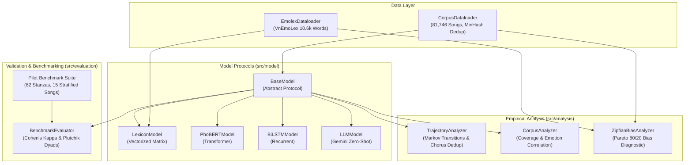

# ViEmoLyrics: A Corpus-Driven Computational Analysis of Emotion Dynamics in Vietnamese Song Lyrics

[](https://www.python.org/)
[](data/)
[](src/dataloader/)
[](data/pilot/)
[](LICENSE)
[](https://www.springer.com/gp/computer-science/lncs)

**ViEmoLyrics** provides an end-to-end computational research framework for investigating emotional dynamics, semantic skew, and structural transitions across Vietnamese song lyrics. Built upon an ultra-clean corpus of **81,746 unique Vietnamese songs (16.86M words)** and an extended **VnEmoLex** lexicon, this repository enables reproducible emotion classification, intra-song Markov trajectory modeling, Zipfian Pareto bias quantification, and zero-shot LLM evaluation.

---

## 🔬 Scientific Motivation & The Dual-Skew Phenomenon

Unigram lexicon-based methods (such as *VnEmoLex*) frequently underperform in computational poetics and lyrical emotion recognition. Through empirical diagnostics and human-grounded evaluation, this project demonstrates that this degradation is driven by two compounding statistical biases:

1. **Lexicon-Level Asymmetry**: In VnEmoLex, only 4,414 out of 10,626 words carry Plutchik emotion tags. Within this emotional vocabulary, *Anticipation* (34.0%) and *Joy* (26.7%) account for **48.26%** of all annotated emotion words.
2. **Corpus-Level Zipfian Concentration**: In Vietnamese lyrics, emotional vocabulary exhibits extreme Pareto concentration: **the top 111 most frequent emotion words account for exactly 80.00% of all emotion token occurrences**. Within these 111 words, 70 words encode Joy or Anticipation (accounting for **67.54%** of high-frequency hits).

When these two skews compound, unigram counters systematically over-predict Joy and Anticipation, collapsing baseline inter-rater agreement to near chance ($\kappa = 0.1631$).

```
┌─────────────────────────┐       ┌─────────────────────────┐
│   VnEmoLex Dictionary   │       │ Vietnamese Song Corpus  │
│  48.3% Joy/Anticipation │   ×   │   Top 111 Words = 80%   │
│     (Static Skew)       │       │    (Zipfian Skew)       │
└────────────┬────────────┘       └────────────┬────────────┘
             │                                 │
             └───────────────┬─────────────────┘
                             ▼
               Systematic Over-Prediction of
                 Joy & Anticipation in NLP
```

---

## 📐 Architecture Overview



---

## 📊 Three-Way Pilot Benchmark (62 Stanzas / 15 Songs)

To establish an empirical baseline before large-scale inference, a multi-rater diagnostic pilot was conducted across 62 stanzas sampled from 15 songs stratified across genres:

| Evaluator Pair | Observed Accuracy | Chance Agreement ($P_e$) | Cohen's Kappa ($\kappa$) | Agreement Level |
|:---|:---:|:---:|:---:|:---:|
| **Human vs. Gemini Argon 4 High** | **61.29%** (38/62) | 0.3468 | **0.4074** | **Moderate Agreement** |
| **Human vs. VnEmoLex (Baseline)** | 25.81% (16/62) | 0.1134 | 0.1631 | Slight Agreement |
| **Gemini Argon vs. VnEmoLex** | 25.81% (16/62) | 0.1353 | 0.1420 | Slight Agreement |

- **Sadness F1**: Gemini Argon achieved $F_1 = 0.800$ on Sadness stanzas (matching human lyrical melancholy).
- **Disagreement Diagnostics**: 54.2% of disagreements between Human and LLM reflect **Plutchik Tertiary Dyads** (e.g., *Trust + Sadness = Empathy / Compassion*), indicating multi-label emotional blending in Vietnamese poetry.

---

## 🚀 Quickstart

ViEmoLyrics follows a clean, modular object-oriented architecture adhering to PEP 8 standards:

```python
# ==============================================================================
import numpy as np

from dataloader import CorpusDataloader, EmolexDataloader
from evaluation import BenchmarkEvaluator
from model import LexiconModel, ModelParams
# ==============================================================================

# 1. Load lexicon and initialize model
emolex_loader  =  EmolexDataloader()
emolex_dict    =  emolex_loader.load(path  =  "data/emolex.xlsx")
model          =  LexiconModel(emolex  =  emolex_dict, params  =  ModelParams())

# 2. Predict emotion for a lyric segment
tokens  =  np.array(["yêu", "thương", "nắng", "ấm", "áp"], dtype  =  str)
result  =  model.predict_single(tokens  =  tokens)

print(f"Dominant Emotion : {result.emotions}")
print(f"Emotion Scores   : {result.scores}")
print(f"Corpus Coverage  : {result.metadata['coverage']}")

# 3. Evaluate inter-annotator agreement
evaluator  =  BenchmarkEvaluator()
metrics    =  evaluator.compute_agreement(
    annotator_a  =  ["joy", "sadness", "anticipation"],
    annotator_b  =  ["joy", "sadness", "trust"],
)
print(f"Cohen's Kappa (kappa) : {metrics.cohens_kappa}")
# ==============================================================================
```

---

## 📂 Repository Structure

```
song-corpus/
├── data/
│   └── pilot/
│       ├── pilot_15_songs.json               # 15 sampled songs with full stanza splits
│       └── pilot_master_benchmark_62stanzas.csv # 62 ground truth annotations (Human, LLM, VnEmoLex)
├── src/
│   ├── analysis/
│   │   ├── bias.py                           # Zipfian & Pareto 80/20 dual-skew analyzer
│   │   ├── statistics.py                     # Corpus-wide emotion statistics & coverage
│   │   └── trajectory.py                     # Intra-song Markov transitions & chorus dedup
│   ├── dataloader/
│   │   ├── corpus.py                         # Corpus data structures (CorpusData, CorpusInstance)
│   │   ├── dataloader.py                     # CSV, Excel, Parquet loaders & Underthesea tokenization
│   │   └── emolex.py                         # Bitmask & matrix representations for VnEmoLex
│   ├── evaluation/
│   │   └── benchmark.py                      # Cohen's Kappa & Plutchik emotion dyad evaluator
│   ├── model/
│   │   ├── bilstm.py                         # Recurrent neural baseline protocol
│   │   ├── lexicon.py                        # Vectorized VnEmoLex prediction model
│   │   ├── llm.py                            # Zero-shot LLM prompt model
│   │   ├── model.py                          # BaseModel, ModelParams, ModelResult protocols
│   │   └── phobert.py                        # Transformer (PhoBERT-v2) fine-tuning protocol
│   └── __init__.py                           # Master package export
├── tools/
│   └── annotate_pilot.html                   # Single-file HTML/JS pilot annotation tool
├── pyproject.toml                            # Project metadata & dependency specifications
└── README.md                                 # Research documentation
```

---

## 📖 Citation

If you use ViEmoLyrics in your academic research, please cite our forthcoming study:

```bibtex
@inproceedings{nguyen2026viemolyrics,
  title     = {A Corpus-Driven Computational Analysis of Emotion Dynamics in Vietnamese Song Lyrics},
  author    = {Nguyen, Duc Huy and Nguyen, Quoc Binh},
  booktitle = {Proceedings of the International Conference on Computational Science and Its Applications (ICCSA 2026)},
  series    = {Lecture Notes in Computer Science (LNCS)},
  publisher = {Springer},
  year      = {2026}
}
```

---

## 📄 License

This repository is licensed under the [MIT License](LICENSE).
